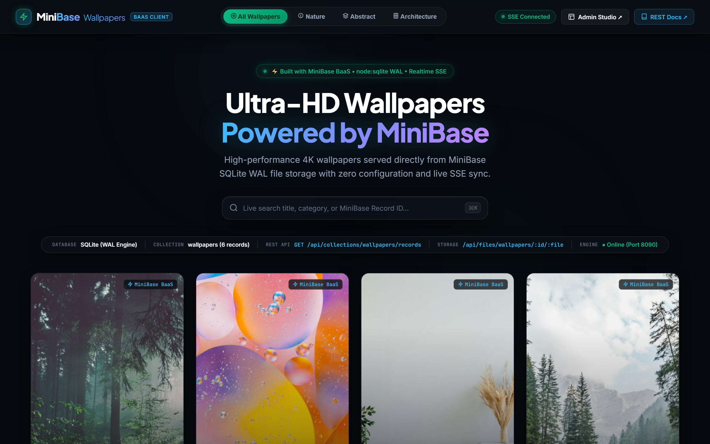
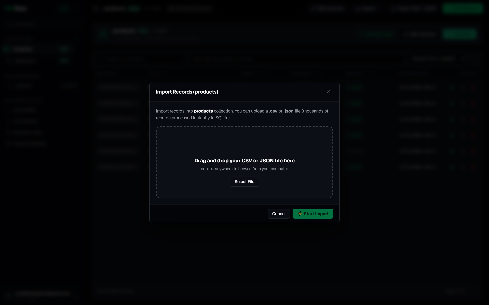

<div align="center">


# MiniBase

**Lightweight embedded Backend-as-a-Service (BaaS) for Node.js and SQLite.**

[](https://nodejs.org/)
[](https://www.sqlite.org/)
[](LICENSE)

[Quick Start](#quick-start) • [Why MiniBase?](#why-minibase-comparison-with-firebase) • [Features](#features) • [CLI Reference](#cli-reference) • [REST API](#rest-api) • [Client Examples](#client-examples)

---

</div>

MiniBase is an embedded Backend-as-a-Service built on Node 22's native `node:sqlite` engine in WAL mode. It bundles automated REST APIs, real-time Server-Sent Events (SSE), file storage, and an administrative dashboard into a single process with zero external database servers to configure.

Designed for side projects, MVPs, internal tooling, and local-first apps where running and paying for separate database servers is unnecessary.

---

## Overview

<div align="center">
  
</div>

<details>
<summary><strong>View additional screenshots</strong> (Client Demo, CLI, API Docs, Importer)</summary>
<br />

| Demo Client App (`/demo`) | Interactive API Docs (`/docs`) |
|:---:|:---:|
|  |  |

| Terminal CLI Suite | CSV / JSON Importer |
|:---:|:---:|
|  |  |

</details>

---

## Why MiniBase? (Comparison with Firebase)

Firebase popularized rapid backend development through real-time syncing and managed auth. However, managing cloud consoles, usage-based pricing, and proprietary document queries can add friction for smaller teams and independent developers.

MiniBase brings the same rapid-backend workflow to a self-hosted, single-file SQLite database.

| Dimension | Firebase | MiniBase |
|---|---|---|
| Architecture | Managed multi-tenant cloud | Single-process self-hosted |
| Database | Firestore / Realtime DB (NoSQL) | SQLite WAL (ACID relational) |
| Data ownership | Hosted by Google Cloud | Single local file (`data.db`) |
| Cost | Pay-per-operation & bandwidth | Free / Self-hosted on any host |
| Real-time | WebSocket protocol | Server-Sent Events (SSE) |
| Local workflow | Cloud emulators & service keys | Run directly with `minibase serve` |
| Querying | Firestore Query API | REST filters & direct SQL CLI |
| API Docs | Google documentation | Auto-generated OpenAPI 3.0 (`/docs`) |

### When to choose which:
- **Choose Firebase** if you need global multi-region replication, managed push notifications (FCM), or deep Google Cloud ecosystem integrations.
- **Choose MiniBase** if you want full data ownership, predictable $0 hosting, microsecond SQLite queries, and a self-contained backend running on a VPS or local machine with ~35MB RAM footprint.

---

## Features

- **Embedded SQLite Engine**: Runs on Node 22's native `node:sqlite` in WAL mode for concurrent reads/writes and microsecond query latency.
- **Automated REST APIs**: Dynamic endpoints generated for each collection schema with filtering, sorting, pagination, and relation expansion.
- **Real-time Event Streaming**: Native Server-Sent Events (SSE) push database changes live to frontend clients without WebSocket overhead.
- **Admin Studio**: Dark-mode web interface to design schemas, manage permissions, and inspect or edit records inline.
- **Terminal CLI**: Global `minibase` CLI to inspect health, manage admins, run raw SQL queries, and manage hot backups.
- **Interactive API Documentation**: Live OpenAPI 3.0 specification explorer powered by Scalar mounted at `/docs`.
- **Bulk Data Migration**: RFC 4180-compliant CSV and JSON import/export with live validation and atomic batch insertion.
- **File Storage**: Local file upload handling with automated thumbnail generation.
- **Cloudflare Tunnel Support**: Single-flag public HTTPS tunnel for testing webhooks and mobile apps without router configuration.

---

## Quick Start

### Prerequisites
- Node.js 22.0.0 or higher.

### Local Setup
```bash
# 1. Clone repository
git clone https://github.com/kothalkarkkartik/MiniBase.git
cd MiniBase

# 2. Install dependencies
npm install

# 3. Start MiniBase Studio
node bin/minibase.js serve --open
```

Admin Studio opens at `http://localhost:8090/_/`. Default credentials:
- **Email**: `admin@minibase.io`
- **Password**: `admin12345`

### Linux / VPS Automated Setup
```bash
curl -fsSL https://raw.githubusercontent.com/kothalkarkkartik/MiniBase/main/scripts/install.sh | bash
```
Sets up Node 22 if missing, creates a `systemd` background service, and configures the global `minibase` CLI.

### Docker
```bash
docker compose up -d
```
Data persists in `./minibase_data`.

---

## CLI Reference

MiniBase includes a command-line interface for administration and automated workflows:

```bash
# Start server
minibase serve --open

# Start with a public HTTPS Cloudflare tunnel
minibase serve --tunnel

# Check server status, active port, collections, and process PID
minibase status

# Execute raw SQL directly against SQLite WAL
minibase sql "SELECT id, title, category FROM wallpapers LIMIT 5;"

# Admin management
minibase admin list
minibase admin create admin@example.com mypassword
minibase admin passwd admin@example.com newpassword
minibase admin delete admin@example.com

# Collection management
minibase collections list
minibase collections delete old_temp_data

# Data migration
minibase export wallpapers ./wallpapers.csv
minibase import wallpapers ./wallpapers.csv

# Hot database backup
minibase backup ./backups/db.backup
```

---

## Client Examples

### JavaScript / TypeScript
```javascript
const BASE_URL = 'http://localhost:8090';

// 1. Fetch records
async function getPosts() {
  const res = await fetch(`${BASE_URL}/api/collections/posts/records?sort=-created`);
  const data = await res.json();
  return data.items;
}

// 2. Create record
async function createPost(payload) {
  const res = await fetch(`${BASE_URL}/api/collections/posts/records`, {
    method: 'POST',
    headers: { 'Content-Type': 'application/json' },
    body: JSON.stringify(payload),
  });
  return res.json();
}

// 3. Real-time subscriptions via SSE
const sse = new EventSource(`${BASE_URL}/api/realtime`);
sse.addEventListener('create', (event) => {
  const { collection, record } = JSON.parse(event.data);
  console.log(`New record in ${collection}:`, record);
});
```

### Dart / Flutter
```dart
import 'dart:convert';
import 'package:http/http.dart' as http;

class MiniBaseClient {
  static const String baseUrl = 'http://localhost:8090';

  static Future<List<dynamic>> fetchRecords(String collection) async {
    final res = await http.get(Uri.parse('$baseUrl/api/collections/$collection/records?sort=-created'));
    if (res.statusCode == 200) {
      return jsonDecode(res.body)['items'];
    }
    throw Exception('Failed to load records');
  }

  static Future<Map<String, dynamic>> insertRecord(String collection, Map<String, dynamic> data) async {
    final res = await http.post(
      Uri.parse('$baseUrl/api/collections/$collection/records'),
      headers: {'Content-Type': 'application/json'},
      body: jsonEncode(data),
    );
    return jsonDecode(res.body);
  }
}
```

### Python
```python
import requests

BASE_URL = "http://localhost:8090"

# Fetch records
res = requests.get(f"{BASE_URL}/api/collections/posts/records?sort=-created")
records = res.json().get("items", [])

# Insert record
payload = {"title": "Hello World", "published": True}
post_res = requests.post(f"{BASE_URL}/api/collections/posts/records", json=payload)
```

### cURL
```bash
# Fetch paginated records
curl -X GET "http://localhost:8090/api/collections/posts/records?page=1&perPage=20"

# Insert a record
curl -X POST "http://localhost:8090/api/collections/posts/records" \
     -H "Content-Type: application/json" \
     -d '{"title":"First Post","published":true}'
```

---

## REST API

| Endpoint | Method | Description |
| :--- | :---: | :--- |
| `/api/collections` | `GET` | List all collections |
| `/api/collections` | `POST` | Create a collection schema |
| `/api/collections/:col/records` | `GET` | List records (`?page=1&perPage=30&sort=-created&filter=...`) |
| `/api/collections/:col/records/:id` | `GET` | Retrieve single record |
| `/api/collections/:col/records` | `POST` | Create a new record |
| `/api/collections/:col/records/:id` | `PATCH` | Update a record |
| `/api/collections/:col/records/:id` | `DELETE` | Delete a record |
| `/api/collections/:col/export` | `GET` | Export records as CSV or JSON |
| `/api/collections/:col/import` | `POST` | Bulk import records with atomic SQLite transactions |
| `/api/batch` | `POST` | Atomic batch operations |
| `/api/admins/auth-with-password` | `POST` | Admin authentication & token generation |
| `/api/collections/:authCol/auth-with-password` | `POST` | User authentication |
| `/api/files/:col/:id/:filename` | `GET` | File delivery & thumbnail generation |
| `/api/realtime` | `GET` | Server-Sent Events (SSE) live event stream |
| `/docs` | `GET` | Interactive OpenAPI 3.0 documentation |
| `/api/admins/backup/export` | `GET` | Download full database JSON archive |
| `/api/admins/backup/restore` | `POST` | Restore database archive |

---

## Demo Application

A complete client application demonstrating file storage, REST querying, and live SSE updates is included in [`examples/wallpaper-app`](examples/wallpaper-app) and served at:

👉 `http://localhost:8090/demo`

---

## Environment Variables

| Variable | Default | Description |
| :--- | :---: | :--- |
| `PORT` | `8090` | Server HTTP port |
| `HOST` | `0.0.0.0` | Bind address |
| `DATA_DIR` | `./minibase_data` | Storage directory for SQLite database and uploaded files |
| `JWT_SECRET` | auto-generated | Secret key for signing tokens |
| `NODE_ENV` | `production` | Environment mode (`development` / `production`) |
| `MINIBASE_TUNNEL` | `false` | Start Cloudflare tunnel on launch |

---

## License

MIT &copy; Kartik Kothalkar. See [LICENSE](LICENSE) for details.
