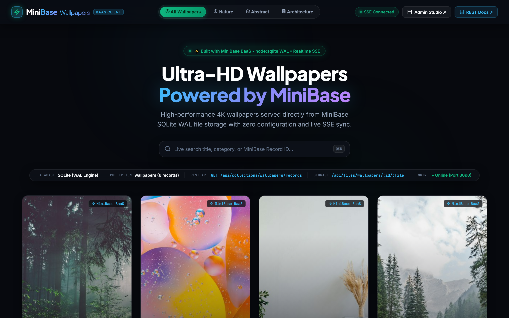

# 🖼️ WallVibe — 4K Wallpapers Demo App

> A production-ready client application built with vanilla JavaScript, modern glassmorphism CSS, and powered end-to-end by the **MiniBase BaaS Engine**.



---

## ⚡ How it Connects to MiniBase

This application demonstrates the four core superpowers of MiniBase:

1. **Native SQLite File Storage**:
   Wallpapers are stored in MiniBase's local storage and served with automated caching via:
   ```
   GET /api/files/wallpapers/:id/:filename
   ```

2. **Automated REST APIs**:
   The frontend queries the `wallpapers` collection dynamically:
   ```javascript
   // Fetch sorted wallpapers by creation date
   const res = await mb.request('/api/collections/wallpapers/records?sort=-created');
   ```

3. **Live Server-Sent Events (SSE)**:
   When any user downloads an image, the download counter increments in MiniBase and broadcasts an SSE event to update all active browser windows live without polling:
   ```javascript
   mb.collection('wallpapers').subscribe('*', (event) => {
     console.log('Live MiniBase DB Update:', event);
     loadWallpapers();
   });
   ```

4. **Live Engine Telemetry**:
   The glass telemetry bar displays connected collection status, SQLite WAL mode, and server response health.

---

## 🚀 Running the Demo

When MiniBase is running (`node bin/minibase.js serve`), the demo app is mounted automatically at:

👉 **`http://localhost:8090/demo`** (also accessible via `/app` or `/wallpapers`)
